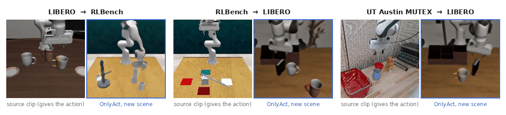
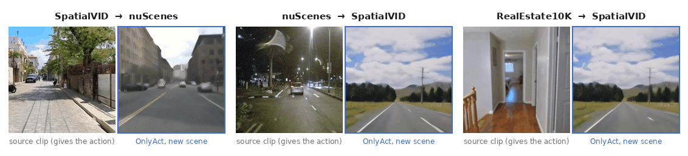
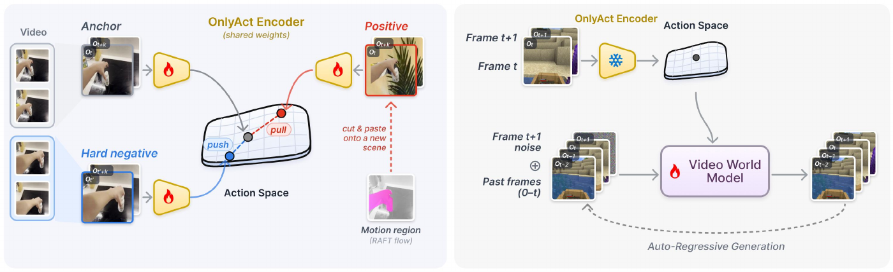

<div align="center">

# 🎬 OnlyAct

### Extracting Action Representations from Foundation Models for World Models

Runjia Li · Minghao Chen · Junyu Xie · Philip Torr · Andrea Vedaldi · Tomas Jakab

University of Oxford · **NeurIPS 2026**

[](https://runjiali-rl.github.io/onlyact/)
[](https://huggingface.co/liguang0115/justact)
[](https://runjiali-rl.github.io/onlyact/)
[](#%EF%B8%8F-installation)
[](LICENSE)




<sub>🎥 The action is read from the <b>source clip</b> (left of each pair) and played out by the OnlyAct world model in a <b>different scene</b> (right, blue frame), without a single action label. Selected examples from the released world model; many more on the <a href="https://runjiali-rl.github.io/onlyact/">project page</a>.</sub>

</div>

## ✨ Highlights

- 🏷️ **No action labels.** The encoder is adapted on unlabelled video only: 168,000 frame pairs from nine datasets.
- 🪶 **Lightweight.** Only LoRA adapters inside V-JEPA 2 ViT-L are trained: 7.1 million parameters, 1.5 hours on one RTX 4090.
- 🎯 **Expressive.** Highest mean linear-probe R² (0.490) over 13 datasets, best on 11 of them (Table 1).
- 🧹 **Scene-invariant.** The highest average held-out LPIPS in Table 4: the least scene information a decoder can recover, by that measure.
- 🌍 **Transferable.** The action of one video drives an AdaWorld world model in another scene (Table 2) and adapts to new domains with few labels (Table 3).
- 🔁 **Reproducible.** Code, checkpoints and the evaluation protocol of every table in the paper.

## 🧭 Method

<p align="center"></p>

OnlyAct turns a self-supervised video encoder into an action encoder, without action labels. A frame pair goes into
V-JEPA 2 ViT-L as one two-frame clip. The encoder's tokens are mean-pooled, a fixed random projection maps them to 640
dimensions, and the result is L2-normalised. Only LoRA adapters inside the encoder are trained (7.1 million parameters,
1.5 hours on one RTX 4090), with a contrastive loss on 168,000 frame pairs from nine video datasets. The positive of a pair
is the same motion pasted into another scene, and the hard negative is another moment of the same clip. The embedding can
then replace the latent action of a world model.

This repository contains the code, the checkpoints and the evaluation protocol for every table of the paper.

## 📁 Contents

| folder | what it does | paper |
|---|---|---|
| 🧠 `onlyact/` | the encoder, embedding extraction and the contrastive training code (`onlyact/training/`) | all |
| 🧪 `baselines/` | AdaWorld and DreamDojo latent action models retrained on our frame pairs: training and extraction | all |
| 📏 `probe/` | linear probe of action information | Table 1 |
| 🌍 `worldmodel/` | AdaWorld world model conditioned on an external action representation: training, rollouts, scoring | Table 2 |
| 🎮 `downstream/` | fine-tuning of the world models on new domains, generation, inverse-dynamics classifiers, scoring | Table 3 |
| 🔍 `leakage/` | frame-reconstruction decoder that measures scene leakage | Table 4 |
| 🗂️ `data/` | clip lists, splits and pair lists of every evaluation (relative paths), and the data preparation scripts | all |
| 📋 `tables/` | one script per table: result files -> LaTeX | all |
| ▶️ `scripts/` | one script per table that runs the whole evaluation | all |
| 📦 `checkpoints/` | download instructions and checksums of the released weights | all |

`baselines/`, `worldmodel/`, `downstream/`, `leakage/`, `onlyact/training/`, `data/probe/` and `checkpoints/` have their
own README with the protocol, the commands and the compute cost; the linear probe (`probe/probe.py`) and the table
scripts (`tables/`) are described in their module docstrings.

## ⚙️ Installation

Two Python environments are used (Python 3.12, CUDA 12.8):

```bash
conda create -n onlyact python=3.12 && conda activate onlyact
pip install -r requirements/encoder.txt        # encoder, extraction, probe, leakage decoder, encoder training

conda create -n onlyact-wm python=3.12 && conda activate onlyact-wm
pip install -r requirements/worldmodel.txt     # world model, downstream fine-tuning, latent-action baselines
```

The versions are the ones that produced the paper's numbers.

## 📦 Checkpoints

The weights are on Hugging Face at https://huggingface.co/liguang0115/justact; see
[`checkpoints/README.md`](checkpoints/README.md) for the download command. In short: the OnlyAct adapters and projection (37 MB), the two
retrained latent action models (1.9 GB and 2.8 GB), the four world models (about 230 MB each) and the small Table 3
classifiers and interfaces. V-JEPA 2 and the AdaWorld base model are downloaded from their authors.

## 🚀 Using the encoder

```python
import numpy as np
from onlyact import OnlyActEncoder

encoder = OnlyActEncoder("checkpoints/onlyact", device="cuda:0")   # OnlyActEncoder(None) = frozen V-JEPA 2
pair = np.stack([frame_t, frame_t_plus_1])                         # (2, H, W, 3) uint8 RGB
embedding = encoder.encode([pair])                                 # (1, 640) float32, unit norm
```

For a whole clip list (one row per consecutive frame pair):

```bash
python -m onlyact.extract --manifest data/probe/libero.json --data_root $DATA/probe/libero \
    --ckpt checkpoints/onlyact --out_dir runs/emb/onlyact/libero
```

## 🗂️ Data

No frames or other data are distributed with this repository. `data/` holds only the clip lists, splits and source /
target pairs of the evaluations (frame paths relative to a data root), the list of training samples and the scripts
that prepare each dataset. Download each dataset from its source and prepare it with these scripts:

| needed for | datasets | download and preparation |
|---|---|---|
| Table 1, Table 4 | the 13 probe datasets | [`data/probe/README.md`](data/probe/README.md) |
| Table 2 | LIBERO, RLBench, SpatialVID | [`data/probe/README.md`](data/probe/README.md) (the same frames as Table 1) |
| Table 2 | nuScenes v1.0-mini | [`worldmodel/README.md`](worldmodel/README.md) |
| Table 3 | DMLab, Minecraft, Habitat, nuScenes | [`downstream/README.md`](downstream/README.md) |
| encoder training, world-model training | the nine training datasets | [`onlyact/training/README.md`](onlyact/training/README.md) |

The scripts in `scripts/` read everything from one data root `$DATA`: `probe/`, `leakage128/` and `eval_data/` (frames,
128x128 frames and action targets, all written by `data/probe/prepare/`, whose requirements are in
`data/probe/prepare/requirements.txt`), `nuscenes_mini/` and `downstream/<domain>/`. Each dataset keeps its own
licence; the READMEs above give it as stated by the source.

## 📊 Reproducing the tables

Each script skips outputs that already exist, so it can be stopped and restarted. Times are for one RTX 4090.

| table | command | GPU time |
|---|---|---|
| Table 1, linear probing | `DATA=... bash scripts/reproduce_table1.sh` | about 6 h (extraction of 5 representations on 13 datasets, 195 probes) |
| Table 2, world model | `DATA=... bash scripts/reproduce_table2.sh` (after Table 1) | about 24 h (1,120 rollouts) |
| Table 3, downstream fine-tuning | `DATA=... bash scripts/reproduce_table3.sh` | about 3 h before fine-tuning, 50-80 h with the 12 fine-tuning runs |
| Table 4, scene leakage | `DATA=... bash scripts/reproduce_table4.sh` (after Table 1) | about 10 h (208 decoders) |

`PY_ENC` and `PY_WM` select the Python of the two environments. The training of every model is also included:
`onlyact/training/` (encoder), `baselines/train.py`, `worldmodel/train.py` and `downstream/train.py`.

## 🔬 Reproducibility

- ✅ On the same GPU model and software versions, embedding extraction, the linear probe, world-model rollouts and
  downstream generation are deterministic. The LoRA adapters are merged into the bfloat16 encoder weights on the CPU,
  and the rounding of that merge depends on the number of CPU threads: `OnlyActEncoder` merges with 6 threads, as in
  the paper.
- ⚠️ On other GPU models, bfloat16 embeddings differ slightly (cosine similarity above 0.998 to the paper's files). This moves
  probe values by up to about 0.015 R^2.
- 🎲 The random control of Table 1 is drawn by `probe/make_random.py`. The paper's MUTEX random-control file came from an
  earlier draw that was not logged: the released script gives -0.158 there instead of the paper's -0.156 (both at chance).
  The random control of every other dataset is reproduced exactly.
- 🔀 The leakage decoders and the fine-tuning runs are not bit-reproducible (non-deterministic backward passes): expect
  about 0.001-0.004 LPIPS (Table 4) and about 0.01 dB (Table 3).

## 📝 Citation

```bibtex
@inproceedings{li2026onlyact,
  title     = {OnlyAct: Extracting Action Representations from Foundation Models for World Models},
  author    = {Li, Runjia and Chen, Minghao and Xie, Junyu and Torr, Philip and Vedaldi, Andrea and Jakab, Tomas},
  booktitle = {Advances in Neural Information Processing Systems},
  year      = {2026}
}
```

## ⚖️ Licence

The code in this repository is released under the Apache License 2.0 ([`LICENSE`](LICENSE)); third-party code keeps its
own licence ([`NOTICE`](NOTICE)).

## 🙏 Acknowledgements

The world model builds on [AdaWorld](https://github.com/Little-Podi/AdaWorld) and the latent-action baselines on AdaWorld
and [DreamDojo](https://github.com/NVIDIA/DreamDojo); their code is included under the Apache License 2.0 (see
[`NOTICE`](NOTICE)). The encoder adapts [V-JEPA 2](https://github.com/facebookresearch/vjepa2) (MIT licence). Each dataset
keeps its own licence.

The GIFs above show frames from LIBERO, RLBench, UT Austin MUTEX, SpatialVID, nuScenes and RealEstate10K next to OnlyAct
generations; each dataset keeps its own licence.
